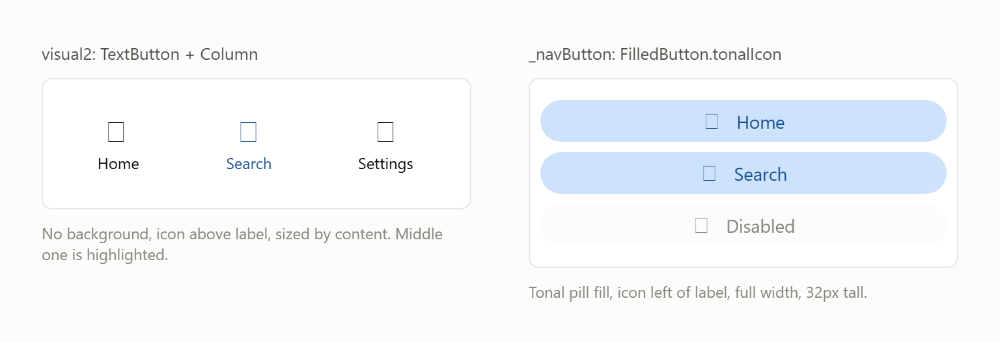

# The different button styles

The two widgets are different button types with different layout and styling. The picture is an approximation of Material 3 defaults, not a pixel-exact render.

| | `visual2` | `_navButton` |
|---|---|---|
| Button type | `TextButton` | `FilledButton.tonalIcon` |
| Background | None, transparent | Tonal fill (`secondaryContainer`) |
| Shape | Rounded rectangle (M3 default, with ink splash) | `StadiumBorder`, a full pill |
| Icon and label | Stacked in a `Column`, icon above text | Side by side in a `Row`, icon left of label |
| Width | Shrinks to its content (`mainAxisSize.min`) | Fills the available width, because `Size.fromHeight(32)` means `Size(double.infinity, 32)` |
| Height | Content-driven, at least 40 by default | Fixed minimum of 32 |
| Outer spacing | `Padding(4)` around it | None |
| Label | Optional (`if (_label != null)`) | Always shown (`_label ?? "--"`) |
| Highlighted state | Text and icon turn `colorScheme.primary` | None, so you can't show a "selected" state |
| Disabled state | Faded text and icon | Faded fill and content |

Things to watch for:

- **Icon size:** `TextButton` uses the default 24px icon, while `tonalIcon` uses 18px. Your `// size: 16` comment is not applied, so pass `iconSize` in the style if you want 16.
- **Width in a `Row`:** `Size.fromHeight` gives an infinite minimum width. Placed in a `Row` without `Expanded` or `Flexible`, it throws an unbounded-width layout error. It works in a `Column` or inside `Expanded`.
- **Look:** `visual2` suits toolbars and bottom-bar-style items, where a highlight tints the content. `_navButton` suits stacked or full-width actions, where the tonal fill is what makes it look like a button.
- **Missing semicolon:** `visual2` is missing a `;` after the `return Padding(...)` expression.

If you want `_navButton` to stack the icon above the label like `visual2` while keeping the tonal fill, use a plain `FilledButton.tonal` with the same `Column` as its child.